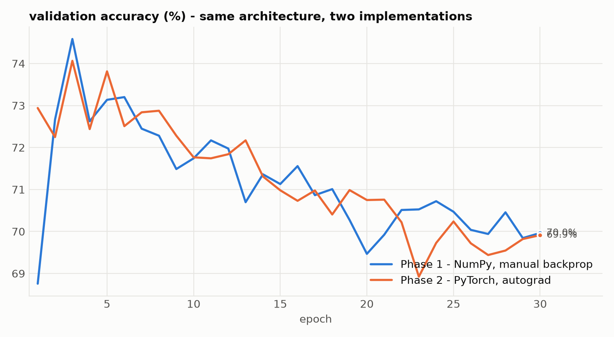
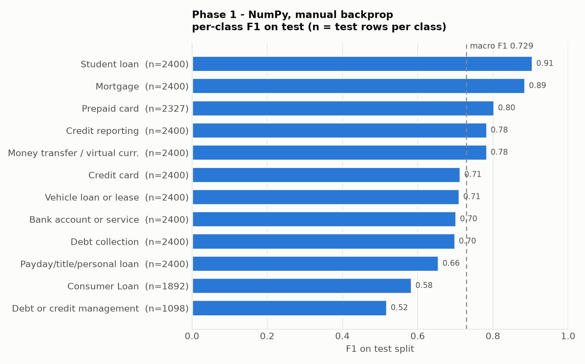
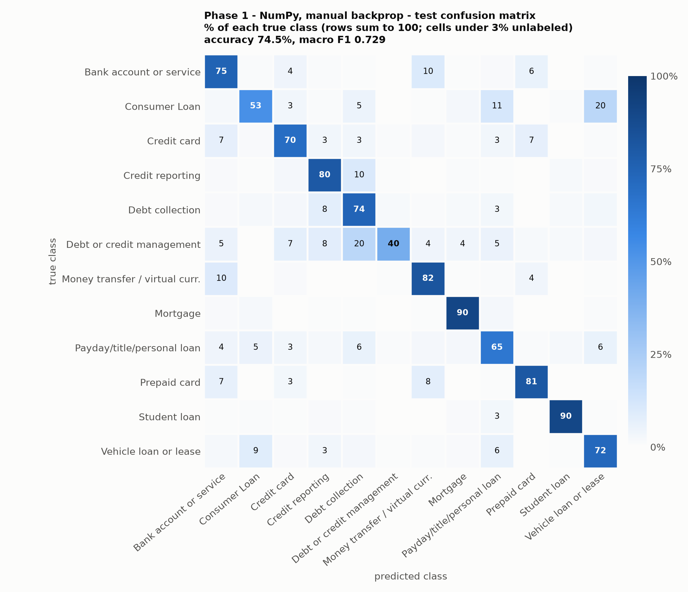

# Consumer Complaint Triage: an MLP built from scratch

I built a multilayer perceptron (MLP) from scratch in NumPy (every layer, the backward passes, the loss and the optimizer, no autograd) to understand what happens inside a neural network. I applied it to sorting CFPB consumer complaints into 12 product categories.


To check my hand-written backpropagation, I rebuilt the same network in PyTorch with autograd. The two match: they reach their best validation loss at the same epoch and achieve 74.54% and 74.10% test accuracy, respectively. A simple TF-IDF + logistic regression baseline scores higher at 77.24%, and I explain why below.



## Results

All numbers are on the held-out **test split (26,917 complaints)**, evaluated **once**, using the checkpoint with the lowest validation loss. Hyperparameters were tuned on the validation split only.

| Model | Test accuracy | Macro F1 | Best epoch |
|---|---|---|---|
| **Phase 1:** MLP, NumPy, hand-written backprop | **74.54%** | **0.729** | 3 of 30 |
| **Phase 2:** same MLP, PyTorch autograd | 74.10% | 0.726 | 3 of 30 |
| Baseline: TF-IDF (unigrams) + logistic regression | 77.24% | 0.758 | n/a |

- **The port matches.** After the first epoch the two phases follow almost the same validation curve: both reach their best validation loss at epoch 3 (1.1760 vs 1.1781) and overfit the same way afterwards.
- **A linear baseline beats the MLP by about 2.7 points.** See *What I found* and *Limitations*.
- Each configuration was trained **once, with seed 42**. Differences below about one point are within what a different seed could produce.

| Per-class F1 (Phase 1) | Confusion matrix (Phase 1, % of each true class) |
|---|---|
|  |  |

Training curves: [Phase 1](results/numpy/curves.png) · [Phase 2](results/torch/curves.png). Raw numbers: `results/*/metrics.json`, `results/baseline_tfidf.json`. Full logs: `results/*/train_log.txt`.

## What I found


**1. The weakest classes may reflect label ambiguity, not just model limitations.** *Debt or credit management* and *Consumer Loan* had the lowest recall across the NumPy MLP, PyTorch MLP, and TF-IDF baseline. Their recall scores, in that order, were 0.40 / 0.53, 0.37 / 0.56, and 0.46 / 0.58. In the test set, 22% of *Consumer Loan* complaints were classified as *Vehicle loan* and 11% as *Payday/personal loan*, categories that reflect changes in the CFPB’s product taxonomy. Errors for *Debt or credit management* were spread across several categories, consistent with it being a broad catch-all label. When classes overlap by definition, a model may not be able to separate them reliably, so label ambiguity may account for part of the roughly 75% accuracy ceiling.

**2. A checkpoint bug that gradient checks couldn't catch.** I made a BatchNorm mistake I'd been warned about in Karpathy's lectures: when restoring the best epoch, I saved the model weights but not BatchNorm's running mean and variance. Short runs never exposed it, because with one epoch the best epoch is also the last one; it only surfaced after a full 30-epoch run, where the epoch-3 weights were evaluated with epoch-30 statistics and test accuracy fell to 30%. Gradient checks didn't catch it because the bug was in checkpointing, not the math. I fixed it by saving the running statistics too, and added an assertion that the restored model reproduces its recorded validation loss.

**3. Why the MLP loses to logistic regression.** Sum-pooling (B, 400, 64) -> (B, 64) squashes the whole complaint into 64 numbers, gives every word equal footing in the sum (common words like "the" or "xxxx" are never down-weighted), and adds the padding tokens in too, so the vector accidentally encodes length. TF-IDF keeps one weighted feature per word (12,550 of them) and down-weights words that appear everywhere. Both see only which words occur, not their order, so this is a fair comparison of representations.

**4. The model saturates almost immediately.** In both phases the best epoch is 3 of 30. After that the model clearly overfits: training loss keeps going down while validation loss rises, so extra epochs are just memorising. This is consistent with a bag-of-words ceiling: the representation is exhausted early.

## Data

[CFPB Consumer Complaint Database](https://www.consumerfinance.gov/data-research/consumer-complaints/), public complaints with a consumer-written narrative.

Preprocessing (`src/prepare_data.py`):
- keep only rows that have a narrative
- merge renamed/overlapping product labels (e.g. the three "Credit reporting ..." variants into *Credit reporting*, the three "Payday loan ..." variants into *Payday/title/personal loan*), drop *Other financial service*, giving **12 classes**
- cap each class at 12,000 rows by random downsampling (no oversampling); three classes stay below the cap (*Consumer Loan*, *Debt or credit management*, *Prepaid card*)
- stratified **64 / 16 / 20** train/val/test split, `random_state=42`: 86,134 / 21,534 / 26,917 rows

## Model

```
token ids (B, 400)
  -> Embedding (V, 64), summed over the 400 positions  -> (B, 64)
  -> Linear 64->256 (no bias) -> BatchNorm -> ReLU -> Dropout 0.5
  -> Linear 256->64 (no bias) -> BatchNorm -> ReLU -> Dropout 0.5
  -> Linear 64->12                                     -> (B, 12) logits
loss: cross-entropy with label smoothing 0.1
```

- **Tokenisation** (`src/vocab.py`): lower-cased whitespace split, words seen at least 10 times in train, `<PAD>`=0, `<UNK>`=1, padded/truncated to 400 tokens. The CFPB redaction token `xxxx` is kept.
- **Training:** AdamW (lr 1e-3, weight decay 1e-3), batch 32, 30 epochs, checkpoint by lowest validation loss.
- **Written from scratch in Phase 1** (`src/`): `Module`, `Linear`, `ReLU`, `BatchNorm1d`, `LayerNorm1d`, `Dropout`, `Embedding` (sum-pooled), `CrossEntropyLoss` (numerically stable, label smoothing), `AdamW`, batching and checkpointing. Each layer's backward pass is verified against central-difference numerical gradients (agreement around 1e-10).

### Phase 1 vs Phase 2: what is and isn't identical
Matched: architecture, label smoothing, dropout, embedding init N(0, 0.01²), BatchNorm momentum (0.7 in Phase 1's convention = `momentum=0.3` in PyTorch's, which weights the new batch), optimizer, data, seed value.
Not matched:
- Linear-layer init: He-normal in Phase 1, PyTorch's default Kaiming-uniform in Phase 2. Phase 1 starts with larger logits (first loss 3.78 vs 2.58), which explains its slower first epoch (68.8% vs 72.9%).
- BatchNorm running variance: biased (Phase 1) vs unbiased (PyTorch).
- Random number streams (NumPy vs PyTorch), so batch order and dropout masks differ.

## How to run

Tested on Windows, Python 3.13.

```
git clone https://github.com/Fyl3x/complaint-triage-mlp
cd complaint-triage-mlp
py -3.13 -m venv venv
venv\Scripts\activate
python -m pip install -r requirements.txt
```

**Data:** download the complaints CSV from the CFPB page above, put it at `data\complaints.csv`, then:
```
mkdir data\processed
python src/prepare_data.py
```

**Gradient checks** (no data needed):
```
python -m src.linear
python -m src.batchnorm
python -m src.layernorm
python -m src.embedding
```

**Phase 1** (NumPy, about 4 min/epoch on CPU, about 2 h for 30 epochs):
```
set MLP_BACKEND=numpy
python train_numpy.py            # --epochs N for a quick run
```
`src/backend.py` uses CuPy instead of NumPy when CuPy and a CUDA GPU are available (`pip install cupy-cuda12x`); set `MLP_BACKEND=numpy` to force the CPU. The published numbers come from the NumPy path.

**Phase 2** (PyTorch, under a minute per epoch on an RTX 3050). Install the CUDA build of PyTorch that matches your driver (see pytorch.org), e.g.:
```
python -m pip install torch --index-url https://download.pytorch.org/whl/cu128
python train_torch.py
```

**Baseline and figures:**
```
python baseline_tfidf.py
python plot_results.py
```

## Repository layout

```
src/                 hand-written layers, optimizer, vocab, data prep, NumPy/CuPy backend
train_numpy.py       Phase 1 training + test evaluation
train_torch.py       Phase 2 training + test evaluation
baseline_tfidf.py    TF-IDF + logistic regression baseline
plot_results.py      figures from results/*/metrics.json
results/             metrics, logs and figures for every published number
notebooks/           data exploration
```

## Limitations and next steps

- **Bag of words only:** no word order, no sequence model, no attention, no pretrained embeddings.
- **Padding is not masked:** `<PAD>` embeddings are summed in, so the pooled vector partly encodes length. Masking padding and trying mean or TF-IDF-weighted pooling are the obvious next experiments; any such v2 would be tuned on validation and reported next to these results.
- **Whitespace tokenisation keeps punctuation attached** (`loan.` and `loan` are different tokens); TF-IDF's tokenizer strips it, which is part of the baseline's advantage.
- **Single seed per configuration:** no variance estimate.
- Some Phase 1 hyperparameters (dropout, BatchNorm momentum, label smoothing) are hard-coded inside `src/` instead of passed in.

## License

MIT, see [LICENSE](LICENSE).
